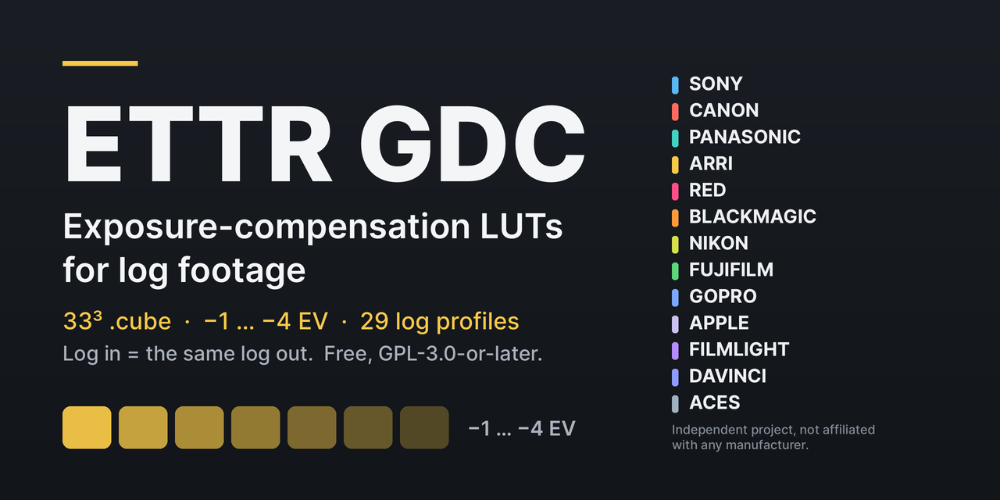

# ETTR GDC

[English](README.md) · [Română](README.ro.md) · **Español**

  

**LUTs `.cube` 33³ gratuitas de compensación de exposición para material log — para monitorización y etalonaje ETTR. Log de entrada = el mismo log de salida.**

Para directores de fotografía, DIT y coloristas que exponen a la derecha y quieren ver o etalonar la imagen con el brillo previsto (−1 … −4 EV, de medio en medio, 29 perfiles log).

**ETTR (Expose To The Right)** es una técnica de exposición: aumentas la exposición capturada manteniendo las altas luces importantes por debajo del límite de saturación del sensor, y luego compensas la imagen para visualizarla o en posproducción. Las LUTs ETTR GDC ofrecen solo esa compensación negativa de la imagen; no realizan por sí solas la exposición ETTR y no protegen el sensor frente a la sobreexposición.

**[Descarga](https://github.com/gordasgdc/ettr-gdc/releases/latest)** · **[Sitio web](https://gordas.dev/ettr/es/)** · Guías: [EN](README.md) · [RO](README.ro.md) · [ES](README.es.md)

Véase también: [ZONA GDC](https://github.com/gordasgdc/zona-gdc) — LUTs de monitorización para guía de exposición (https://gordas.dev/zona-gdc/es/).

**Qué descargas:** `ETTR_GDC-1.0.0-portable.zip` (LUTs + documentos, cualquier sistema / tarjeta de cámara) o `ETTR_GDC-1.0.0-macOS-icons.zip` (mismos ficheros con iconos de carpeta en Finder), más `SHA256SUMS.txt`.

> **Límites:** no sustituye a un filtro ND, no recupera altas luces, la salida sigue siendo log y necesita una transformación de visualización adecuada; no probado en todas las cámaras y monitores. Detalles abajo.

### De un vistazo

| Marca | Perfiles incluidos | Notas |
|---|---|---|
| Sony | 3 | S-Log2 / S-Log3 (S-Gamut, S-Gamut3, S-Gamut3.Cine); copias de 6 caracteres para visores |
| Canon | 3 | Canon Log, Log 2, Log 3; códigos de rango legal |
| Panasonic | 1 | V-Log / V-Gamut |
| ARRI | 12 | LogC3 (EI 160–1600, 11 EI) y LogC4 |
| RED | 1 | Log3G10 / REDWideGamutRGB |
| Blackmagic | 1 | solo Film Gen5 — Gen4 no incluido |
| Nikon | 1 | N-Log |
| Fujifilm | 2 | F-Log, F-Log2 |
| GoPro | 1 | solo la curva Protune (Flat) — GP-Log no incluido |
| Apple | 1 | Apple Log (v1) — Apple Log 2 no incluido |
| FilmLight | 1 | T-Log / E-Gamut |
| DaVinci | 1 | DaVinci Intermediate (espacio de trabajo) |
| ACES | 1 | ACEScct (espacio de trabajo) |

## Qué es

ETTR GDC es un conjunto de LUTs `.cube` 33×33×33 que aplican una *compensación de exposición conocida* al material log. Cada LUT decodifica la curva log de la cámara a scene-linear, multiplica por 2^(−stops) y recodifica con la **misma** curva y la **misma** gama. Siete pasos por perfil: −1, −1,5, −2, −2,5, −3, −3,5 y −4 EV. La operación es separable por canal, así que las LUTs de perfiles con la misma curva son numéricamente idénticas (p. ej. las dos gamas S-Log3).

Uso típico: expones deliberadamente a la derecha (ETTR) para alejar la señal del ruido y quieres ver/etalonar la imagen con el brillo previsto. Cargas la LUT que corresponde a tu compensación y la imagen vuelve a la exposición prevista.

## Advertencias — leer primero

- **No sustituye a un filtro ND.** No reduce la luz que llega al sensor.
- **No recupera altas luces** ya recortadas o saturadas en el material. No es un rescate de sobreexposición.
- **La salida sigue siendo una imagen log.** Para verla correctamente sigues necesitando la transformación de visualización adecuada (DRT / output transform). No es una LUT Rec.709 ni un look creativo.
- No se han probado todas las cámaras ni monitores. No se afirma «compatible con todas las cámaras»; véase Compatibilidad.
- Proyecto independiente. Sin afiliación, respaldo ni patrocinio de ningún fabricante de cámaras o software; los nombres de marca solo identifican los formatos que publican.

## Descarga

No hace falta cuenta ni pago. Dos archivos con los mismos 224 ficheros `.cube`:

- **Portátil** (Windows, Linux, tarjeta de cámara): `ETTR_GDC-1.0.0-portable.zip` — solo LUTs y documentos, sin ficheros de Finder.
- **macOS con iconos de carpeta**: `ETTR_GDC-1.0.0-macOS-icons.zip` — los mismos ficheros más iconos personalizados en Finder. `zip`/`rsync` simples pierden los iconos; descomprime con Utilidad de Archivos o `ditto -x -k`.

Sumas de control: `SHA256SUMS.txt`. Release: https://github.com/gordasgdc/ettr-gdc/releases/tag/v1.0.1

## Perfiles

29 perfiles, 28 curvas únicas, 203 LUTs en las carpetas de perfil (196 tablas únicas), más 21 copias con nombre corto para visores Sony = **224 ficheros `.cube`**.

| Marca | Carpeta | Gama | Código corto |
|---|---|---|---|
| Sony | `S-Log2_S-Gamut` | S-Gamut | `SLog2-SG` |
| Sony | `S-Log3_S-Gamut3.Cine` | S-Gamut3.Cine | `SLog3-SG3C` |
| Sony | `S-Log3_S-Gamut3` | S-Gamut3 | `SLog3-SG3` |
| Canon | `Canon-Log_Cinema-Gamut` | Cinema Gamut | `CLog-CG` |
| Canon | `Canon-Log2_Cinema-Gamut` | Cinema Gamut | `CLog2-CG` |
| Canon | `Canon-Log3_Cinema-Gamut` | Cinema Gamut | `CLog3-CG` |
| Panasonic | `V-Log_V-Gamut` | V-Gamut | `VLog-VG` |
| ARRI | `LogC3_AWG3_EI0160` | ARRI Wide Gamut 3 | `LogC3-EI160` |
| ARRI | `LogC3_AWG3_EI0200` | ARRI Wide Gamut 3 | `LogC3-EI200` |
| ARRI | `LogC3_AWG3_EI0250` | ARRI Wide Gamut 3 | `LogC3-EI250` |
| ARRI | `LogC3_AWG3_EI0320` | ARRI Wide Gamut 3 | `LogC3-EI320` |
| ARRI | `LogC3_AWG3_EI0400` | ARRI Wide Gamut 3 | `LogC3-EI400` |
| ARRI | `LogC3_AWG3_EI0500` | ARRI Wide Gamut 3 | `LogC3-EI500` |
| ARRI | `LogC3_AWG3_EI0640` | ARRI Wide Gamut 3 | `LogC3-EI640` |
| ARRI | `LogC3_AWG3_EI0800` | ARRI Wide Gamut 3 | `LogC3-EI800` |
| ARRI | `LogC3_AWG3_EI1000` | ARRI Wide Gamut 3 | `LogC3-EI1000` |
| ARRI | `LogC3_AWG3_EI1280` | ARRI Wide Gamut 3 | `LogC3-EI1280` |
| ARRI | `LogC3_AWG3_EI1600` | ARRI Wide Gamut 3 | `LogC3-EI1600` |
| ARRI | `LogC4_AWG4` | ARRI Wide Gamut 4 | `LogC4-AWG4` |
| RED | `Log3G10_REDWideGamutRGB` | REDWideGamutRGB | `L3G10-RWG` |
| Blackmagic | `Film-Gen5_BMD-WG-Gen5` | Blackmagic Wide Gamut Gen5 | `BMDGen5` |
| Nikon | `N-Log_N-Gamut` | N-Gamut (Rec.2020 primaries) | `NLog-NG` |
| Fujifilm | `F-Log_F-Gamut` | F-Gamut (Rec.2020 primaries) | `FLog-FG` |
| Fujifilm | `F-Log2_F-Gamut` | F-Gamut (Rec.2020 primaries) | `FLog2-FG` |
| GoPro | `Protune-Flat_Protune-Native` | Protune Native | `Protune` |
| Apple | `Apple-Log_Rec2020` | Rec.2020 | `AppleLog` |
| FilmLight | `T-Log_E-Gamut` | E-Gamut | `TLog-EG` |
| DaVinci | `DaVinci-Intermediate_DWG` | DaVinci Wide Gamut | `DI-DWG` |
| ACES | `ACEScct_AP1` | ACES AP1 | `ACEScct` |

## Cómo elegir perfil y compensación

1. Localiza el perfil log de tu cámara (en ARRI LogC3, también el EI con el que grabaste).
2. Elige cuántos stops sobreexpusiste a propósito (−1 … −4 EV, de medio en medio).
3. Usa `<código>_ETTR-<n>EV.cube` (p. ej. `VLog-VG_ETTR-2EV.cube`, `1_5` = 1,5).

Si tu exposición difiere en una fracción, elige el paso más cercano y afina con tu propio control de exposición.

## Monitorización, aplicado o metadatos

- **Monitorización:** cárgala en un monitor/grabador que acepte `.cube` 33³ como LUT de *look/monitor*, aplicada antes de la transformación de visualización del monitor. Consulta el manual: muchos solo aceptan 17³ o 33³ y algunos limitan los nombres de fichero (los visores Sony muestran 6 caracteres — usa `Sony/_Viewfinder_6char`).
- **Aplicado:** aplicarla en una grabación o render hace el cambio permanente. Hazlo solo deliberadamente.
- **Metadatos:** estas LUTs no son metadatos y no cambian los ajustes de exposición de la cámara ni los datos incrustados del fichero.

## Precisión y límites

La interpolación es tetraédrica/lineal; el cubo tiene 33 nodos por eje. La precisión se audita por fichero (`audit.json`, `INDEX.md`): el error máximo de interpolación frente a la función analítica es inferior a 1,5 códigos de 10 bits en casi todos los perfiles. **Apple Log**: el error mayor (8,77 códigos) se limita a códigos de entrada inferiores a 1/32 (pie profundo, scene-linear por debajo de −0,03); para entradas ≥ 1/32 el máximo es 0,71 códigos. «Error en stops» = |log2(salida de LUT decodificada / salida analítica)| medido donde la salida analítica está al menos 6, 8 o 10 stops por debajo del gris 18%; es una cifra de precisión de la LUT, no una medición de ninguna cámara.

La salida se limita a [0, 1]; en las tablas entregadas ningún nodo está limitado (0 nodos limitados). Las curvas Canon usan códigos de rango legal (64–940).

**No incluidos (límites exactos):** Blackmagic Film Gen4 (sin especificación pública oficial — solo Gen5), GoPro GP-Log, DJI D-Log, Apple Log 2 (sin primarios/especificación publicados usados aquí), RED Log3G12.

## Compatibilidad

Verificado: las matemáticas (valores de anclaje de documentos de fabricantes, ida y vuelta, escalera de exposición, oráculo independiente Colour 0.4.7) y una verificación de extremo a extremo V-Log en DaVinci Resolve (medido −2,006 y −4,015 stops para los pasos −2 y −4 EV). **No verificado:** monitores, grabadores y cargadores de LUT en cámara, individualmente — comprueba tu equipo. Resolve y otros programas de etalonaje aceptan en general `.cube` 33³.

## Licencia y atribución

Las LUTs pregeneradas y la documentación de esta distribución se licencian bajo **Creative Commons Atribución 4.0 Internacional (CC BY 4.0)** — https://creativecommons.org/licenses/by/4.0/deed.es (`LICENSE`). Puedes usarlas, copiarlas, modificarlas y redistribuirlas, también con fines comerciales, **siempre que cites a «Dumitru Cristinel Gordas — ETTR GDC», enlaces la licencia e indiques si hiciste cambios.** Componentes de terceros y procedencia: `docs/PROVENANCE.md`. Proyecto independiente, sin afiliación ni respaldo de ningún fabricante de cámaras o software; los nombres de marca solo identifican los formatos que publican.

Las copias de la versión 1.0.0 obtenidas anteriormente siguen bajo la licencia con la que se distribuyeron (GPL-3.0-or-later); este cambio no las afecta.
