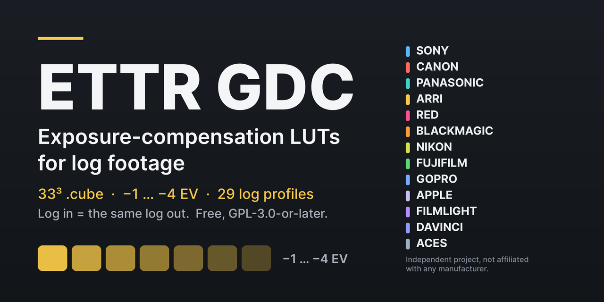

# ETTR GDC

**English** · [Română](README.ro.md) · [Español](README.es.md)

  

**Free 33³ `.cube` LUTs for exposure compensation on log footage — for ETTR monitoring and grading. Log in = the same log out.**

For cinematographers, DITs and colourists who expose to the right and want to see or grade the image at its intended brightness (−1 to −4 EV in half-stop steps, 29 log profiles).

**ETTR (Expose To The Right)** is an exposure technique: you raise the captured exposure while keeping the important highlights below the sensor's saturation limit, then compensate the image for viewing or in post-production. ETTR GDC LUTs provide only that negative compensation of the image; they do not perform ETTR exposure by themselves and do not protect the sensor from overexposure.

**[Download](https://github.com/gordasgdc/ettr-gdc/releases/latest)** · **[Website](https://gordas.dev/ettr/en/)** · Guides: [EN](README.md) · [RO](README.ro.md) · [ES](README.es.md)

See also: [ZONA GDC](https://github.com/gordasgdc/zona-gdc) — exposure-guidance monitoring LUTs (https://gordas.dev/zona-gdc/en/).

**What you download:** `ETTR_GDC-1.0.0-portable.zip` (LUTs + documents, any OS / camera card) or `ETTR_GDC-1.0.0-macOS-icons.zip` (same files with Finder folder icons), plus `SHA256SUMS.txt`.

> **Limits:** not an ND-filter replacement, no highlight recovery, the output is still log and needs a proper display transform; not tested on every camera or monitor. Details below.

### At a glance

| Brand | Profiles included | Notes |
|---|---|---|
| Sony | 3 | S-Log2 / S-Log3 (S-Gamut, S-Gamut3, S-Gamut3.Cine); 6-character copies for viewfinders |
| Canon | 3 | Canon Log, Log 2, Log 3; legal-range codes |
| Panasonic | 1 | V-Log / V-Gamut |
| ARRI | 12 | LogC3 (EI 160–1600, 11 EIs) and LogC4 |
| RED | 1 | Log3G10 / REDWideGamutRGB |
| Blackmagic | 1 | Film Gen5 only — Gen4 not included |
| Nikon | 1 | N-Log |
| Fujifilm | 2 | F-Log, F-Log2 |
| GoPro | 1 | Protune (Flat) curve only — GP-Log not included |
| Apple | 1 | Apple Log (v1) — Apple Log 2 not included |
| FilmLight | 1 | T-Log / E-Gamut |
| DaVinci | 1 | DaVinci Intermediate (working space) |
| ACES | 1 | ACEScct (working space) |

## What it is

ETTR GDC is a set of 33×33×33 `.cube` LUTs that apply a *known exposure compensation* to log footage. Each LUT decodes the log curve of a camera to scene-linear, multiplies by 2^(−stops), and re-encodes with the **same** curve and **same** gamut. Seven steps per profile: −1, −1.5, −2, −2.5, −3, −3.5 and −4 EV. Because the operation is separable per channel, LUTs of profiles sharing a curve are numerically identical (e.g. the two S-Log3 gamuts).

Typical use: you deliberately expose to the right (ETTR) to keep the signal away from the noise floor, and you want to see/grade the image at its intended brightness. Load the LUT that matches your compensation and the image comes back to the intended exposure.

## Warnings — read first

- **It is not a replacement for an ND filter.** It does not reduce the light reaching the sensor.
- **It does not recover highlights** that are already clipped or saturated in the footage. It is not an overexposure rescue.
- **The output is still a log image.** To view it correctly you still need the proper display transform (DRT / output transform). It is not a Rec.709 LUT and not a creative look.
- Not all cameras or monitors have been tested. Nothing here is claimed “compatible with all cameras”; see Compatibility.
- Independent project. Not affiliated with, endorsed by or sponsored by any camera or software manufacturer; brand names are used only to identify the formats they publish.

## Download

No account or payment is needed. Two archives with the same 224 `.cube` files:

- **Portable** (Windows, Linux, camera-card use): `ETTR_GDC-1.0.0-portable.zip` — only LUTs and documents, no Finder files.
- **macOS with folder icons**: `ETTR_GDC-1.0.0-macOS-icons.zip` — same files plus custom Finder folder icons. Plain `zip`/`rsync` drop the icons; unpack it with Archive Utility or `ditto -x -k`.

Checksums: `SHA256SUMS.txt`. Release: https://github.com/gordasgdc/ettr-gdc/releases/tag/v1.0.1

## Profiles

29 profiles, 28 unique curves, 203 LUTs in profile folders (196 unique tables), plus 21 copies with short names for Sony viewfinders = **224 `.cube` files**.

| Brand | Folder | Gamut | Short code |
|---|---|---|---|
| Sony | `S-Log2_S-Gamut` | S-Gamut | `SLog2-SG` |
| Sony | `S-Log3_S-Gamut3.Cine` | S-Gamut3.Cine | `SLog3-SG3C` |
| Sony | `S-Log3_S-Gamut3` | S-Gamut3 | `SLog3-SG3` |
| Canon | `Canon-Log_Cinema-Gamut` | Cinema Gamut | `CLog-CG` |
| Canon | `Canon-Log2_Cinema-Gamut` | Cinema Gamut | `CLog2-CG` |
| Canon | `Canon-Log3_Cinema-Gamut` | Cinema Gamut | `CLog3-CG` |
| Panasonic | `V-Log_V-Gamut` | V-Gamut | `VLog-VG` |
| ARRI | `LogC3_AWG3_EI0160` | ARRI Wide Gamut 3 | `LogC3-EI160` |
| ARRI | `LogC3_AWG3_EI0200` | ARRI Wide Gamut 3 | `LogC3-EI200` |
| ARRI | `LogC3_AWG3_EI0250` | ARRI Wide Gamut 3 | `LogC3-EI250` |
| ARRI | `LogC3_AWG3_EI0320` | ARRI Wide Gamut 3 | `LogC3-EI320` |
| ARRI | `LogC3_AWG3_EI0400` | ARRI Wide Gamut 3 | `LogC3-EI400` |
| ARRI | `LogC3_AWG3_EI0500` | ARRI Wide Gamut 3 | `LogC3-EI500` |
| ARRI | `LogC3_AWG3_EI0640` | ARRI Wide Gamut 3 | `LogC3-EI640` |
| ARRI | `LogC3_AWG3_EI0800` | ARRI Wide Gamut 3 | `LogC3-EI800` |
| ARRI | `LogC3_AWG3_EI1000` | ARRI Wide Gamut 3 | `LogC3-EI1000` |
| ARRI | `LogC3_AWG3_EI1280` | ARRI Wide Gamut 3 | `LogC3-EI1280` |
| ARRI | `LogC3_AWG3_EI1600` | ARRI Wide Gamut 3 | `LogC3-EI1600` |
| ARRI | `LogC4_AWG4` | ARRI Wide Gamut 4 | `LogC4-AWG4` |
| RED | `Log3G10_REDWideGamutRGB` | REDWideGamutRGB | `L3G10-RWG` |
| Blackmagic | `Film-Gen5_BMD-WG-Gen5` | Blackmagic Wide Gamut Gen5 | `BMDGen5` |
| Nikon | `N-Log_N-Gamut` | N-Gamut (Rec.2020 primaries) | `NLog-NG` |
| Fujifilm | `F-Log_F-Gamut` | F-Gamut (Rec.2020 primaries) | `FLog-FG` |
| Fujifilm | `F-Log2_F-Gamut` | F-Gamut (Rec.2020 primaries) | `FLog2-FG` |
| GoPro | `Protune-Flat_Protune-Native` | Protune Native | `Protune` |
| Apple | `Apple-Log_Rec2020` | Rec.2020 | `AppleLog` |
| FilmLight | `T-Log_E-Gamut` | E-Gamut | `TLog-EG` |
| DaVinci | `DaVinci-Intermediate_DWG` | DaVinci Wide Gamut | `DI-DWG` |
| ACES | `ACEScct_AP1` | ACES AP1 | `ACEScct` |

## How to choose a profile and a compensation

1. Find your camera's log profile (and, for ARRI LogC3, the EI you shot at).
2. Pick the number of stops you over-exposed on purpose (−1 … −4 EV, half-stop steps).
3. Use `<code>_ETTR-<n>EV.cube` (e.g. `VLog-VG_ETTR-2EV.cube`, `1_5` = 1.5).

If your exposure differs by a fraction, choose the nearest step and fine-tune with your own exposure control.

## Monitoring, baked-in or metadata

- **Monitoring:** load into a monitor/recorder that accepts 33³ `.cube` as a *look/monitor* LUT, applied before the monitor's own display transform. Check your device manual: many accept 17³ or 33³ only, some limit file names (Sony viewfinders show 6 characters — use `Sony/_Viewfinder_6char`).
- **Baked-in:** applying it in a recording or render makes the change permanent. Do it only deliberately.
- **Metadata:** these LUTs are not metadata and do not change a camera's exposure settings or the file's embedded data.

## Precision and limits

Interpolation is tetrahedral/linear; the cube holds 33 nodes per axis. Precision is audited per file (`audit.json`, `INDEX.md`): maximum interpolation error against the analytic function is below 1.5 10-bit codes for almost all profiles. **Apple Log**: the larger error (8.77 codes) is confined to input codes below 1/32 (deep toe, scene-linear below −0.03); for inputs ≥ 1/32 the maximum is 0.71 codes. “Stop error” = |log2(decoded LUT output / analytic output)| measured where the analytic output is at least 6, 8 or 10 stops below 18% grey; it is a precision figure of the LUT, not a measurement of any camera.

Output is clamped to [0, 1] (a LUT cannot hold values outside the code range); no node is clamped in the supplied tables (0 clamped nodes). Canon curves take legal-range codes (64–940).

**Not included (exact limits):** Blackmagic Film Gen4 (no official public specification — only Gen5 is included), GoPro GP-Log, DJI D-Log, Apple Log 2 (no published primaries/specification used here), RED Log3G12.

## Compatibility

Verified: the maths (anchor values from manufacturer documents, round trip, exposure ladder, independent Colour 0.4.7 oracle) and one end-to-end V-Log check in DaVinci Resolve (measured −2.006 and −4.015 stops for the −2 and −4 EV steps). **Not verified:** individual camera monitors, recorders and in-camera LUT loaders — check your device. Resolve and other grading software accept `.cube` 33³ in general.

## Licence and attribution

The pre-generated LUTs and the documentation in this distribution are licensed under **Creative Commons Attribution 4.0 International (CC BY 4.0)** — https://creativecommons.org/licenses/by/4.0/ (`LICENSE`). You may use, copy, modify and redistribute them, including commercially, **as long as you credit “Dumitru Cristinel Gordas — ETTR GDC”, link the licence and indicate if you made changes.** Third-party components and provenance: `docs/PROVENANCE.md`. Independent project, not affiliated with or endorsed by any camera or software manufacturer; brand names only identify the formats they publish.

Copies of version 1.0.0 obtained earlier remain under the licence they were distributed with (GPL-3.0-or-later); this change does not affect them.
