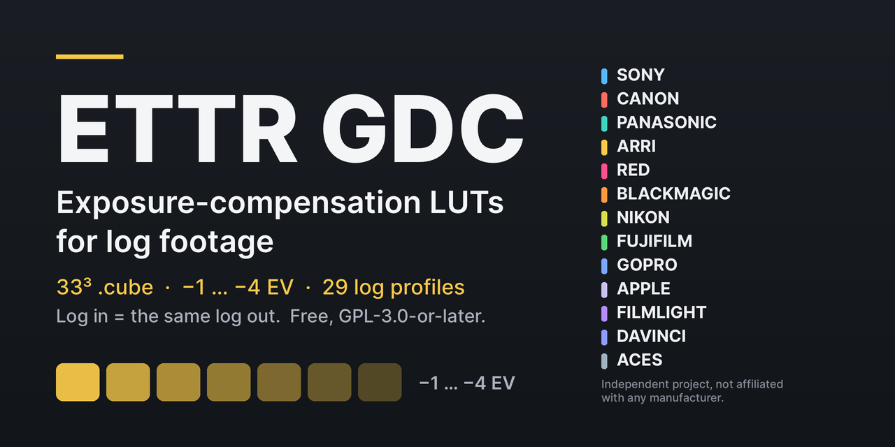

# ETTR GDC

[English](README.md) · **Română** · [Español](README.es.md)

  

**LUT-uri `.cube` 33³ gratuite pentru compensarea expunerii la material log — pentru monitorizare și gradare ETTR. Log la intrare = același log la ieșire.**

Pentru operatori, DIT și coloriști care expun spre dreapta și vor să vadă sau să gradeze imaginea la luminozitatea intenționată (−1 … −4 EV, din jumătate în jumătate, 29 de profiluri log).

**ETTR (Expose To The Right)** este o tehnică de expunere: mărești expunerea capturată, păstrând luminile importante sub limita de saturare a senzorului, apoi compensezi imaginea pentru vizionare sau în postproducție. LUT-urile ETTR GDC oferă doar această compensare negativă a imaginii; ele nu realizează singure expunerea ETTR și nu protejează senzorul împotriva supraexpunerii.

**[Descărcare](https://github.com/gordasgdc/ettr-gdc/releases/latest)** · **[Website](https://gordas.dev/ettr/)** · Ghiduri: [EN](README.md) · [RO](README.ro.md) · [ES](README.es.md)

**Ce descarci:** `ETTR_GDC-1.0.0-portable.zip` (LUT-uri + documente, orice sistem / card de cameră) sau `ETTR_GDC-1.0.0-macOS-icons.zip` (aceleași fișiere cu iconițe de foldere în Finder), plus `SHA256SUMS.txt`.

> **Limite:** nu înlocuiește un filtru ND, nu recuperează luminile, ieșirea rămâne log și cere o transformare de afișare corectă; netestat pe toate camerele și monitoarele. Detalii mai jos.

### Pe scurt

| Marcă | Profiluri incluse | Note |
|---|---|---|
| Sony | 3 | S-Log2 / S-Log3 (S-Gamut, S-Gamut3, S-Gamut3.Cine); copii cu 6 caractere pentru vizoare |
| Canon | 3 | Canon Log, Log 2, Log 3; coduri legal-range |
| Panasonic | 1 | V-Log / V-Gamut |
| ARRI | 12 | LogC3 (EI 160–1600, 11 EI) și LogC4 |
| RED | 1 | Log3G10 / REDWideGamutRGB |
| Blackmagic | 1 | doar Film Gen5 — Gen4 neinclus |
| Nikon | 1 | N-Log |
| Fujifilm | 2 | F-Log, F-Log2 |
| GoPro | 1 | doar curba Protune (Flat) — GP-Log neinclus |
| Apple | 1 | Apple Log (v1) — Apple Log 2 neinclus |
| FilmLight | 1 | T-Log / E-Gamut |
| DaVinci | 1 | DaVinci Intermediate (spațiu de lucru) |
| ACES | 1 | ACEScct (spațiu de lucru) |

## Ce este

ETTR GDC este un set de LUT-uri `.cube` 33×33×33 care aplică o *compensare de expunere cunoscută* materialului log. Fiecare LUT decodează curba log a camerei în scene-linear, înmulțește cu 2^(−stopuri) și re-codifică cu **aceeași** curbă și **aceeași** gamă. Șapte trepte pe profil: −1, −1,5, −2, −2,5, −3, −3,5 și −4 EV. Operația e separabilă pe canal, deci LUT-urile profilelor cu aceeași curbă sunt identice numeric (de ex. cele două game S-Log3).

Utilizare tipică: expui deliberat spre dreapta (ETTR) ca să ții semnalul departe de zgomot și vrei să vezi/gradezi imaginea la luminozitatea intenționată. Încarci LUT-ul care corespunde compensării și imaginea revine la expunerea dorită.

## Avertismente — citește mai întâi

- **Nu înlocuiește un filtru ND.** Nu reduce lumina care ajunge la senzor.
- **Nu recuperează luminile** deja tăiate sau saturate în material. Nu este o soluție de salvare a supraexpunerii.
- **Ieșirea rămâne imagine log.** Pentru vizualizare corectă ai nevoie în continuare de transformarea de afișare potrivită (DRT / output transform). Nu este LUT Rec.709 și nu este un look creativ.
- Nu toate camerele sau monitoarele au fost testate. Nu se afirmă „compatibil cu toate camerele”; vezi Compatibilitate.
- Proiect independent. Fără afiliere, aprobare sau sponsorizare din partea vreunui producător de camere sau software; numele de mărci identifică doar formatele pe care le publică.

## Descărcare

Nu e nevoie de cont sau plată. Două arhive cu aceleași 224 de fișiere `.cube`:

- **Portabilă** (Windows, Linux, card de cameră): `ETTR_GDC-1.0.0-portable.zip` — doar LUT-uri și documente, fără fișiere Finder.
- **macOS cu iconițe de foldere**: `ETTR_GDC-1.0.0-macOS-icons.zip` — aceleași fișiere plus iconițe personalizate în Finder. `zip`/`rsync` simple pierd iconițele; dezarhivează cu Archive Utility sau `ditto -x -k`.

Sume de control: `SHA256SUMS.txt`. Release: https://github.com/gordasgdc/ettr-gdc/releases/tag/v1.0.1

## Profiluri

29 de profiluri, 28 de curbe unice, 203 LUT-uri în folderele de profil (196 tabele unice), plus 21 de copii cu nume scurt pentru vizoarele Sony = **224 de fișiere `.cube`**.

| Marcă | Folder | Gamă | Cod scurt |
|---|---|---|---|
| Sony | `S-Log2_S-Gamut` | S-Gamut | `SLog2-SG` |
| Sony | `S-Log3_S-Gamut3.Cine` | S-Gamut3.Cine | `SLog3-SG3C` |
| Sony | `S-Log3_S-Gamut3` | S-Gamut3 | `SLog3-SG3` |
| Canon | `Canon-Log_Cinema-Gamut` | Cinema Gamut | `CLog-CG` |
| Canon | `Canon-Log2_Cinema-Gamut` | Cinema Gamut | `CLog2-CG` |
| Canon | `Canon-Log3_Cinema-Gamut` | Cinema Gamut | `CLog3-CG` |
| Panasonic | `V-Log_V-Gamut` | V-Gamut | `VLog-VG` |
| ARRI | `LogC3_AWG3_EI0160` | ARRI Wide Gamut 3 | `LogC3-EI160` |
| ARRI | `LogC3_AWG3_EI0200` | ARRI Wide Gamut 3 | `LogC3-EI200` |
| ARRI | `LogC3_AWG3_EI0250` | ARRI Wide Gamut 3 | `LogC3-EI250` |
| ARRI | `LogC3_AWG3_EI0320` | ARRI Wide Gamut 3 | `LogC3-EI320` |
| ARRI | `LogC3_AWG3_EI0400` | ARRI Wide Gamut 3 | `LogC3-EI400` |
| ARRI | `LogC3_AWG3_EI0500` | ARRI Wide Gamut 3 | `LogC3-EI500` |
| ARRI | `LogC3_AWG3_EI0640` | ARRI Wide Gamut 3 | `LogC3-EI640` |
| ARRI | `LogC3_AWG3_EI0800` | ARRI Wide Gamut 3 | `LogC3-EI800` |
| ARRI | `LogC3_AWG3_EI1000` | ARRI Wide Gamut 3 | `LogC3-EI1000` |
| ARRI | `LogC3_AWG3_EI1280` | ARRI Wide Gamut 3 | `LogC3-EI1280` |
| ARRI | `LogC3_AWG3_EI1600` | ARRI Wide Gamut 3 | `LogC3-EI1600` |
| ARRI | `LogC4_AWG4` | ARRI Wide Gamut 4 | `LogC4-AWG4` |
| RED | `Log3G10_REDWideGamutRGB` | REDWideGamutRGB | `L3G10-RWG` |
| Blackmagic | `Film-Gen5_BMD-WG-Gen5` | Blackmagic Wide Gamut Gen5 | `BMDGen5` |
| Nikon | `N-Log_N-Gamut` | N-Gamut (Rec.2020 primaries) | `NLog-NG` |
| Fujifilm | `F-Log_F-Gamut` | F-Gamut (Rec.2020 primaries) | `FLog-FG` |
| Fujifilm | `F-Log2_F-Gamut` | F-Gamut (Rec.2020 primaries) | `FLog2-FG` |
| GoPro | `Protune-Flat_Protune-Native` | Protune Native | `Protune` |
| Apple | `Apple-Log_Rec2020` | Rec.2020 | `AppleLog` |
| FilmLight | `T-Log_E-Gamut` | E-Gamut | `TLog-EG` |
| DaVinci | `DaVinci-Intermediate_DWG` | DaVinci Wide Gamut | `DI-DWG` |
| ACES | `ACEScct_AP1` | ACES AP1 | `ACEScct` |

## Cum alegi profilul și compensarea

1. Găsește profilul log al camerei (la ARRI LogC3, și EI-ul la care ai filmat).
2. Alege câte stopuri ai supraexpus intenționat (−1 … −4 EV, din jumătate în jumătate).
3. Folosește `<cod>_ETTR-<n>EV.cube` (ex. `VLog-VG_ETTR-2EV.cube`, `1_5` = 1,5).

Dacă expunerea diferă cu o fracție, alege treapta cea mai apropiată și ajustează fin cu propriul control de expunere.

## Monitorizare, aplicat definitiv sau metadate

- **Monitorizare:** încarcă într-un monitor/recorder care acceptă `.cube` 33³ ca LUT de *look/monitor*, aplicat înaintea transformării de afișare a monitorului. Verifică manualul aparatului: multe acceptă doar 17³ sau 33³, unele limitează numele fișierelor (vizoarele Sony arată 6 caractere — folosește `Sony/_Viewfinder_6char`).
- **Aplicat definitiv:** aplicarea într-o înregistrare sau randare face schimbarea permanentă. Fă-o doar deliberat.
- **Metadate:** aceste LUT-uri nu sunt metadate și nu schimbă setările de expunere ale camerei sau datele încorporate în fișier.

## Precizie și limite

Interpolarea este tetraedrică/liniară; cubul are 33 de noduri pe axă. Precizia e auditată pe fișier (`audit.json`, `INDEX.md`): eroarea maximă de interpolare față de funcția analitică e sub 1,5 coduri pe 10 biți la aproape toate profilurile. **Apple Log**: eroarea mai mare (8,77 coduri) e limitată la coduri de intrare sub 1/32 (toe adânc, scene-linear sub −0,03); pentru intrări ≥ 1/32 maximul e 0,71 coduri. „Eroarea în stopuri” = |log2(ieșire LUT decodată / ieșire analitică)| măsurată unde ieșirea analitică e cu cel puțin 6, 8 sau 10 stopuri sub grey 18%; e o cifră de precizie a LUT-ului, nu o măsurătoare a vreunei camere.

Ieșirea e limitată la [0, 1]; în tabelele livrate nu e limitat niciun nod (0 noduri limitate). Curbele Canon folosesc coduri legal-range (64–940).

**Neincluse (limite exacte):** Blackmagic Film Gen4 (fără specificație publică oficială — doar Gen5), GoPro GP-Log, DJI D-Log, Apple Log 2 (fără primare/specificație publicată folosită aici), RED Log3G12.

## Compatibilitate

Verificat: matematica (valori de ancorare din documente ale producătorilor, dus-întors, scară de expunere, oracol independent Colour 0.4.7) și o verificare cap-coadă V-Log în DaVinci Resolve (măsurat −2,006 și −4,015 stopuri pentru treptele −2 și −4 EV). **Neverificat:** monitoare, recordere și încărcătoare de LUT din cameră, individual — verifică aparatul tău. Resolve și alte programe de gradare acceptă în general `.cube` 33³.

## Licență și atribuire

LUT-urile pregenerate și documentația din această distribuție sunt licențiate sub **Creative Commons Atribuire 4.0 Internațional (CC BY 4.0)** — https://creativecommons.org/licenses/by/4.0/deed.ro (`LICENSE`). Le poți folosi, copia, modifica și redistribui, inclusiv comercial, **cu condiția să menționezi „Dumitru Cristinel Gordas — ETTR GDC”, să oferi linkul licenței și să indici dacă ai făcut modificări.** Componente terțe și proveniență: `docs/PROVENANCE.md`. Proiect independent, fără afiliere sau susținere din partea vreunui producător de camere sau software; numele de brand identifică doar formatele pe care le publică.

Copiile versiunii 1.0.0 obținute anterior rămân sub licența cu care au fost distribuite (GPL-3.0-or-later); această schimbare nu le afectează.
